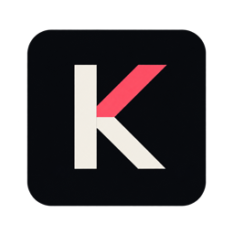
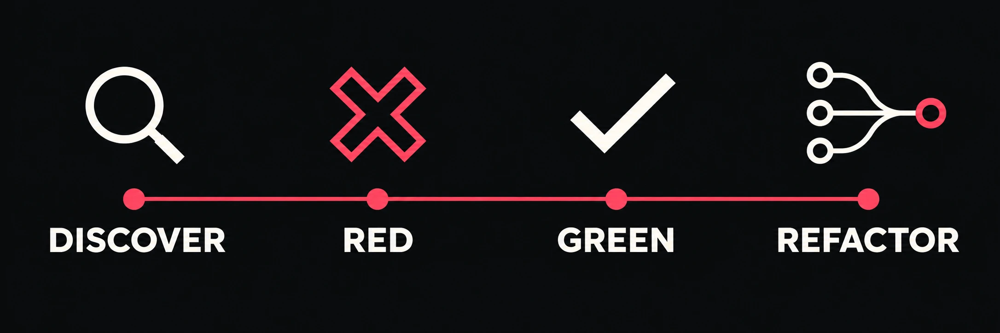

# Kanso (簡素)



**Minimal Code. Maximum Assurance.**


Kanso gives coding agents a clear engineering brief for software, analytics, data science, and AI products. Reuse what works, prove the behavior, and ship the smallest safe change.

**5 language profiles · 6 documented agents · 14 evaluation scenarios**

[Install](#installation) · [Read the skill](skills/kanso/SKILL.md) · [Data and AI playbook](skills/kanso/references/data-and-ai.md)

## Try it

Give your agent a real data or software problem.

> Our revenue dashboard double-counts orders with multiple payments. Reproduce it, fix it in the existing warehouse transform, and show how you reconciled the totals.

Kanso asks for a failing test with representative data, a fix at the existing transformation boundary, and evidence that late events and ordinary orders still work.



## Installation

### Claude Code plugin

Run these in Claude Code. Append `--scope project` to the install command for project scope.

```text
/plugin marketplace add datenwissenschaften/kanso
/plugin install kanso@kanso
```

### Codex plugin

```sh
codex plugin marketplace add datenwissenschaften/kanso
codex plugin add kanso@kanso
```

Start a fresh session. The plugins include a prompt hook that asks the agent to load Kanso on every prompt. In Codex, review and trust the hook in `/hooks` to enable it.

### GitHub Copilot CLI plugin

```sh
copilot plugin marketplace add datenwissenschaften/kanso
copilot plugin install kanso@kanso
```

To request Kanso on every prompt in a repository, [add the activation instruction](#apply-it-on-every-prompt) to `.github/copilot-instructions.md`.

### Other agents and repository installs


Run the [Skills CLI](https://skills.sh/) from your project directory. Add `--global` to install for your user instead.

```sh
npx --yes skills@1.9.1 add datenwissenschaften/kanso --skill kanso
```

The Skills CLI installs the skill from GitHub. For a manual install, [download kanso.zip](https://github.com/datenwissenschaften/kanso/releases/download/v1.2.0/kanso.zip), extract the bundle and [add the activation instruction](#apply-it-on-every-prompt).

### Global installation

Install in your home directory to make the skill available across projects for your user account. On Windows, `~` is your Windows home directory. In WSL, use the Linux home directory if the agent runs there.

| Agent                                                                                    | Personal skills directory                      | Where to add the instruction below                                                                          |
| ---------------------------------------------------------------------------------------- | ---------------------------------------------- | ----------------------------------------------------------------------------------------------------------- |
| [Codex](https://learn.chatgpt.com/docs/build-skills)                                     | `~/.agents/skills/`                            | [Global instructions](https://learn.chatgpt.com/docs/agent-configuration/agents-md) in `~/.codex/AGENTS.md` |
| [Claude Code](https://code.claude.com/docs/en/skills)                                    | `~/.claude/skills/`                            | [User instructions](https://code.claude.com/docs/en/memory) in `~/.claude/CLAUDE.md`                        |
| [Cursor](https://cursor.com/docs/skills)                                                 | `~/.agents/skills/`                            | [User Rules](https://cursor.com/docs/rules) under Customize → Rules                                         |
| [GitHub Copilot](https://docs.github.com/en/copilot/reference/customization-cheat-sheet) | `~/.agents/skills/` on supported local clients | Custom instructions for your client or `.github/copilot-instructions.md` for repository scope               |
| [Gemini CLI](https://geminicli.com/docs/cli/skills/)                                     | `~/.gemini/skills/`                            | [Global context](https://geminicli.com/docs/cli/gemini-md/) in `~/.gemini/GEMINI.md`                        |
| [OpenCode](https://opencode.ai/docs/skills)                                              | `~/.agents/skills/`                            | [Global instructions](https://opencode.ai/docs/instructions) in `~/.config/opencode/AGENTS.md`              |

### Repository-local installation

Extract the archive into the skills directory relative to the repository root. Use this scope when the guidance should apply to a single project. Commit the extracted skill and the instruction file if teammates or cloud agents should receive the same version.

| Agent                   | Repository skills directory | Where to add the instruction below |
| ----------------------- | --------------------------- | ---------------------------------- |
| Codex, Cursor, OpenCode | `.agents/skills/`           | `AGENTS.md`                        |
| Claude Code             | `.claude/skills/`           | `CLAUDE.md`                        |
| GitHub Copilot          | `.agents/skills/`           | `.github/copilot-instructions.md`  |
| Gemini CLI              | `.gemini/skills/`           | `GEMINI.md`                        |

For example, a Codex repository should contain `.agents/skills/kanso/SKILL.md` and a root `AGENTS.md` that points to that file. If your agent requires workspace trust for local skills, enable it for repositories you trust.

### Apply it on every prompt

Add the following block once to the instruction file or setting for your chosen scope. Replace `<skill-file>` with the extracted skill’s path. Use a home-directory path for global instructions and a repository-relative path for repository instructions.

```markdown
## Kanso

On every user prompt, use the kanso skill or read <skill-file>.
Apply the guidance relevant to the task while respecting higher-priority
instructions and repository contracts.
```

Start a fresh session. Try a small task without naming the skill and ask which engineering guidance the agent applied. Skill discovery and instruction scope depend on the agent and client. In Codex, use the active file under `CODEX_HOME` if configured. A non-empty `AGENTS.override.md` takes precedence over `AGENTS.md` there.

For agents without native skill discovery, use the same block in their persistent instructions and point to a readable copy of `SKILL.md` with its companion files. If the client only accepts chat context, supply the skill and relevant references at the start of each session.

### Update or remove

Use the agent's plugin manager to update or uninstall a plugin. For a manual install, review local changes before replacing the `kanso` folder. To uninstall, remove that folder and its instruction block. If you use a development symlink or junction, remove only the link.

Contributors can link an existing clone into the same skills directory for live updates. Keep the released archive as the source for regular installations.

## Benchmark status

**14 scenarios × 4 Codex batches = 56 responses.** The [decision pilot](tests/scenarios/README.md#pilot-results) measured response time and tokens. A separate [Claude Code run](https://github.com/datenwissenschaften/kanso/actions/runs/45971015361) fell below the passing threshold. Both evaluations use written scenarios.

The [agentic benchmark](benchmark/protocol.json) runs Claude Code on working fixtures with and without Kanso and grades each change with hidden tests. A fix counts as proven only when the agent's own tests fail on the original defect.

**3 scenarios × 2 arms × 5 runs = 30 agent sessions, 0 errors.** Claude Code 2.1.292 with `claude-sonnet-5-5`:

| Metric                                     | Baseline          | Kanso           | Verdict      |
| ------------------------------------------ | ----------------- | --------------- | ------------ |
| Solved (hidden acceptance and adversarial) | 15/15 [0.80, 1]   | 15/15 [0.80, 1] | inconclusive |
| Proven (agent test failed on the defect)   | 8/15 [0.30, 0.75] | 15/15 [0.80, 1] | Kanso better |
| Escaped (agent tests green, hidden red)    | 0/15 [0, 0.20]    | 0/15 [0, 0.20]  | inconclusive |
| Agent cost total / per proven fix (USD)    | 0.71 / 0.089      | 1.18 / 0.078    | not tested   |

Brackets are 95 % Wilson intervals. The proven difference is +0.47 [0.17, 0.70]. Baseline proofs per scenario were 0/5 in `bug-fix`, where it added no failing test, 3/5 in `analytics` and 5/5 in `security`. Kanso proved 5/5 in each. Both arms fixed every defect, so the result supports test-first evidence, not better fixes. Kanso spent about 1.7 × the agent cost per run. The [results](benchmark/runs/28a2958e7244/results.json), diffs, transcripts and [report](benchmark/runs/28a2958e7244/index.html) are published. The run cites revision `28a2958`, which became `d5c9c79` when an unrelated document was removed from history. The `benchmark/` tree is identical except that `run.mjs` now replaces the home directory with `~` in published artifacts. The same redaction was applied to four transcripts of this run, and nothing else changed.

[Contribute](CONTRIBUTING.md) · [Changelog](CHANGELOG.md) · [MIT license](LICENSE)
