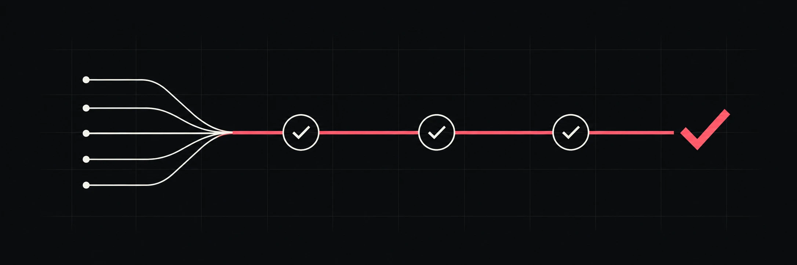

# Engineering Standards

**Minimal Code. Maximum Assurance.**

Give your coding agent a consistent way to deliver small, safe, tested changes. [Engineering Standards](SKILL.md) uses behavior-driven TDD, explicit contracts, mature libraries, and automated checks. It adapts to your repository, with profiles for Python, TypeScript, Rust, Go, and Java.

## Get started

1. [Download the release ZIP](https://github.com/datenwissenschaften/engineering-standards/releases/latest/download/engineering-standards.zip).
2. Extract the skill and enable it for every Codex prompt using the [installation guide](docs/installation.md).

Start a fresh session and give Codex your task as usual.

[Contribute](CONTRIBUTING.md) · [Changelog](CHANGELOG.md) · [MIT license](LICENSE)
